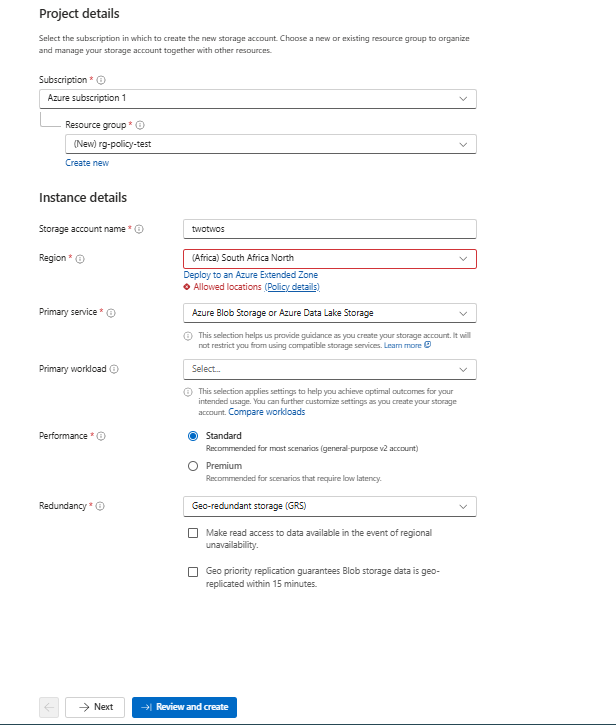
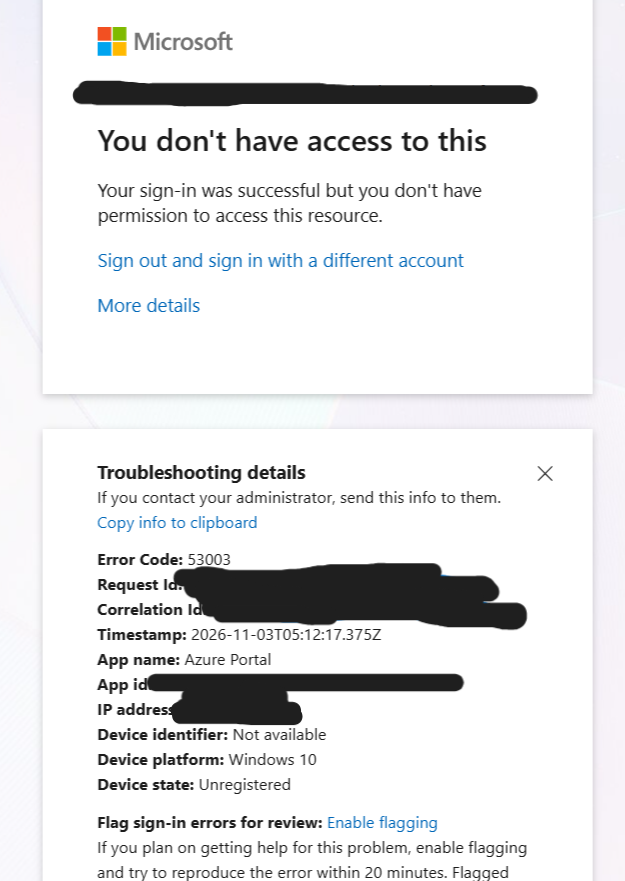
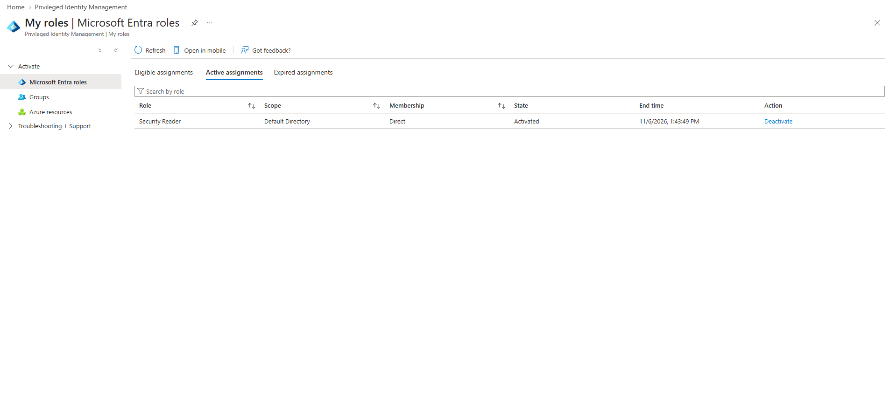

# Cloud Identity and Zero Trust Architecture in Azure

Hands-on lab building Zero Trust controls in Azure and Entra ID, done as an independent study (COP 4900) at USF. Identity is the control plane: every request is verified, privileges are temporary, and guardrails are enforced as code. The lab was torn down after testing, so this repo is the record of what was built and proved.

## What's In Here

* Governance, management group hierarchy (ZT-Lab, ZT-Dev, ZT-Prod), scoped RBAC, and an Azure Policy "Allowed locations" deny assigned at the top and inherited down
* Federation, a SAML enterprise app and an OIDC app registration, with tokens captured and decoded by hand (issuer, audience, signature, validity window)
* Conditional Access, CA001 blocking a test user from Azure Resource Manager with a break-glass account excluded, tested in report-only mode first and then enforced
* Privileged access, PIM eligible assignment for Security Reader, activated with a justification and expired automatically
* Policy as code, a Bicep policy assignment deployed by GitHub Actions using OIDC workload identity federation, so no client secret is stored
* Network segmentation, a VNet with two subnets and default-deny NSGs, plus a deliberate Any/Any rule that was caught and replaced with HTTPS from one admin IP
* Maturity assessment, the lab scored against NIST SP 800-207 and the CISA Zero Trust Maturity Model v2.0

## Stack

`Azure` `Entra ID` `Azure Policy` `Conditional Access` `PIM` `Bicep` `GitHub Actions` `NSG` `Network Watcher`

No SIEM here, on purpose. The goal is identity and access design, independent of a detection pipeline doing the interpretation for me.

## Governance

Creating a storage account in South Africa North is rejected by the Allowed locations policy, which is assigned at ZT-Lab and inherited by everything beneath it.

## Conditional Access

The sign-in succeeded, but CA001 denied access to Azure Resource Manager (error 53003). A separate 401 page during testing was an RBAC denial, so it was not used as evidence.

## Privileged Access

The test user held no standing privileged role. Security Reader was eligible only, activated on demand, and expired on its own.

## Policy as Code

The GitHub Actions workflow authenticates to Azure with a federated credential trusted for the main branch, then deploys the policy from `main.bicep`. It ran successfully and re-ran successfully.

## Zero Trust Assessment

In NIST SP 800-207 terms, Entra Conditional Access acts as the policy decision point and Azure Resource Manager as the enforcement point. The lab follows the identity-driven approach, with basic network segmentation as a second layer.

Against the seven NIST tenets, the lab is strong on per-session least-privilege access (tenet 3), partial on resources (1), secured communication (2), dynamic policy (4), and enforcement before access (6), and has gaps in asset posture monitoring (5) and telemetry (7). The biggest single gap is that no MFA was enforced.

Against the CISA Zero Trust Maturity Model v2.0:

| Pillar | Stage | Notes |
|--------|-------|-------|
| Identity | Initial | Access management is the strongest function (PIM). No MFA, so authentication is Traditional |
| Devices | Not assessed | Out of scope |
| Networks | Initial | Default-deny NSG segmentation. Flow logs enabled but no traffic captured |
| Applications and Workloads | Initial | Policy deployed by CI/CD. No workloads deployed |
| Data | Not assessed | Out of scope |

Full tenet table, per-function ratings, and the steps that would raise each rating are in `maturity-assessment.md`.

## Limitations

* Flow logs are enabled but captured no traffic, since no VMs were deployed
* An access review was created but never completed a cycle
* Defender for Cloud (free tier) showed no findings, so the NSG mistake was caught by review
* Single tenant and single subscription

## Repo Structure

* `.github/workflows/deploy.yml`, the GitHub Actions workflow that deploys the policy using OIDC
* `policy-as-code/main.bicep`, the Allowed locations policy assignment at subscription scope
* `maturity-assessment.md`, the NIST SP 800-207 and CISA ZTMM v2.0 assessment
* `screenshots/`, all evidence screenshots, including the management groups, SAML assertion, OIDC token, and NSG before and after. IDs and IPs are blacked out
